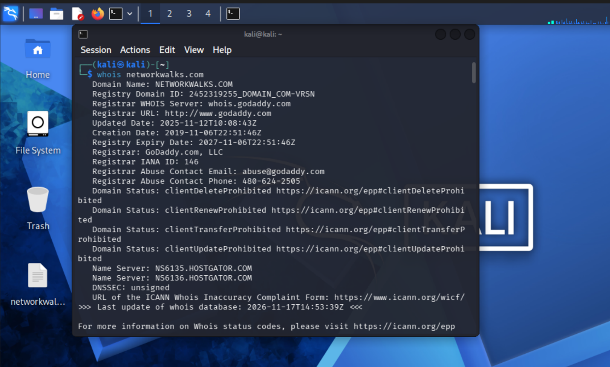
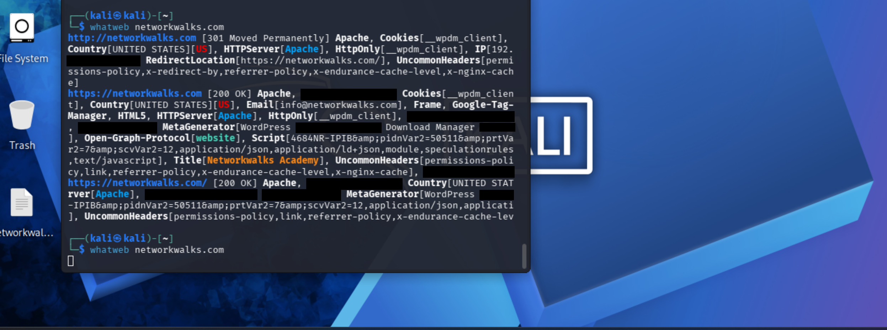
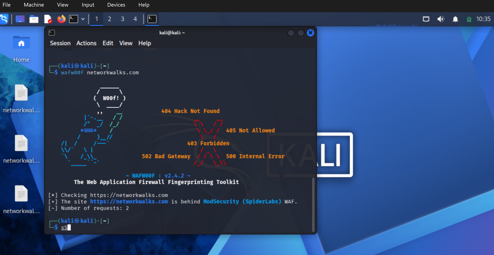
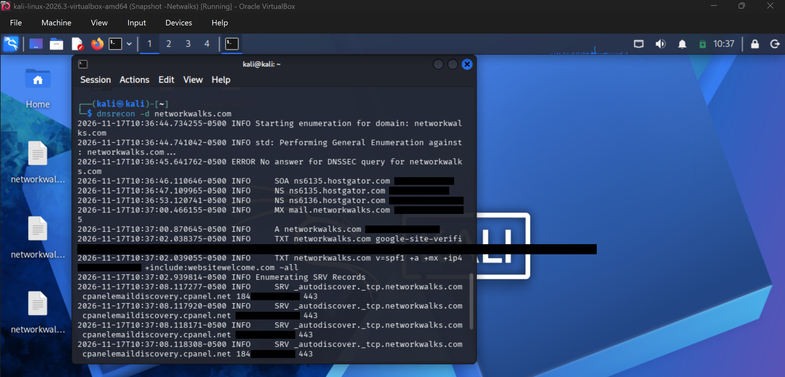
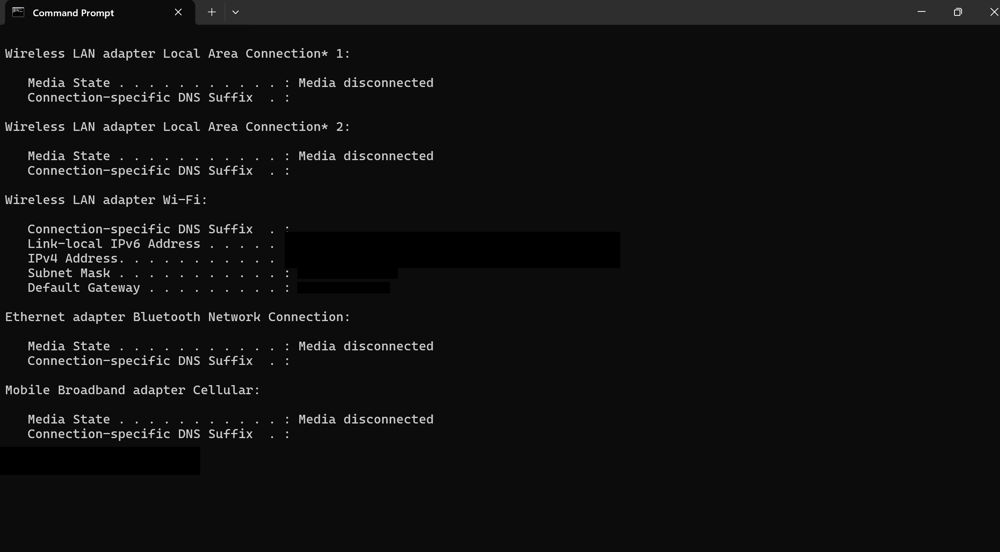
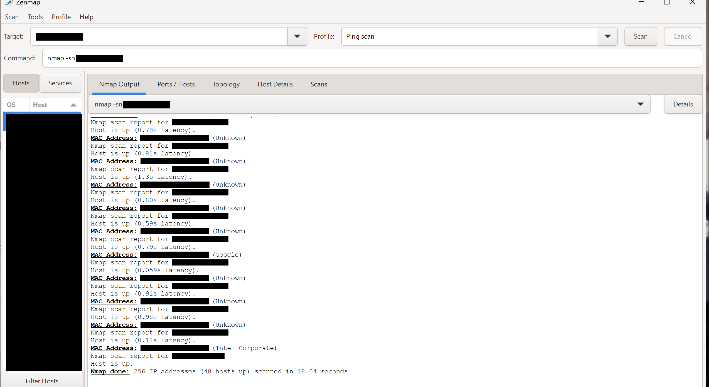
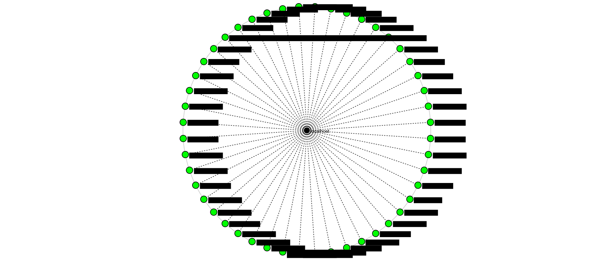

# Penetration Testing Report

## Footprinting and Network Scanning Phases

**W2 PM FINAL | CYBERSECURITY | NETWORKWALKS**

**Author:** Sifa Obedi Kamendu  
**Program:** NETWORKWALKS Cybersecurity Program  
**Batch:** B084  
**Evidence dates:** 13 and 17 November 2026

## 1 Liability Disclaimer

This repository documents educational reconnaissance and network discovery. Further testing requires approval from the system or network owner. No exploitation is documented here. Sensitive identifiers and cookie values have been masked in the public screenshots.

## 2 Introduction

I used Kali Linux to collect domain and website information about networkwalks.com, and Zenmap on Windows to discover live hosts on my local LAN. My final scan detected **48 live hosts**, including my PC, and displayed **47 MAC addresses**.

## 3 Tools Used

| Tool | Purpose |
|---|---|
| WHOIS | Read domain registration information |
| WhatWeb | Identify website technology fingerprints |
| Nslookup | Resolve the domain through DNS |
| curl | Inspect HTTP response headers |
| Wafw00f | Identify a possible web application firewall |
| DNSRecon | Enumerate DNS records |
| ipconfig | Identify the active Windows network configuration |
| Zenmap and Nmap | Discover live hosts and collect MAC addresses |

## 4 Activities Performed

### 4.1 Footprinting and Reconnaissance

#### WHOIS

```bash
whois networkwalks.com
```

The output listed GoDaddy.com LLC as registrar and HostGator name servers. DNSSEC was listed as unsigned.


#### WhatWeb

```bash
whatweb networkwalks.com
```

The HTTP page redirected to HTTPS, which returned 200 OK. The output identified Apache and reported WordPress, WordPress Download Manager and jQuery fingerprints. Detected version labels were not independently verified.


#### DNS Lookup

```bash
nslookup networkwalks.com
```

The domain resolved to an IPv4 address. Addresses are masked in this public screenshot.


#### HTTP Headers

```bash
curl -I https://networkwalks.com
```

The response returned 200 OK and showed Apache, WordPress API links and a cookie with Secure and HttpOnly attributes. The cookie value is masked.


#### WAF Detection

```bash
wafw00f networkwalks.com
```

Wafw00f reported ModSecurity from SpiderLabs. This fingerprint does not confirm how effectively the WAF protects the application.


#### DNS Enumeration

```bash
dnsrecon -d networkwalks.com
```

The visible output included SOA, NS, MX, A, TXT and autodiscover SRV information. A DNSSEC query returned no answer; this alone does not establish a vulnerability.


### 4.2 Network Scanning with Zenmap

I ran `ipconfig` on Windows and selected the active Wi-Fi adapter. Its subnet mask was **255.255.255.0**, equivalent to **/24**. Device addresses and my Windows username are hidden in the public screenshot.


I selected the Ping scan profile in Zenmap to discover live hosts on the LAN.

| Scan result | Value |
|---|---|
| Nmap version | 7.993 |
| IP addresses scanned | 256 |
| Live hosts | 48 including my PC |
| MAC addresses displayed | 47 |
| Own PC MAC address | Not displayed in the scan |
| Scan duration | 18.04 seconds |


I exported the topology as a PDF. The image below is a masked copy of that export. This discovery view does not verify physical cabling or switch connections.


## 5 Risk Analysis and Impact

| Observation | Interpretation |
|---|---|
| Website technologies identifiable | Can guide software inventory checks; versions need verification |
| DNS and HTTP information visible | Helps describe infrastructure; public information alone is not a vulnerability |
| WAF fingerprint detected | Indicates a possible protective component; effectiveness was not tested |
| 48 LAN hosts discovered | Supports inventory checks; does not prove unauthorized devices are present |

No exploitable vulnerability was confirmed by these exercises. Host counts describe the recorded scan and may change over time.

## 6 Recommendations

- Verify installed software versions and maintain supported updates.
- Review HTTP headers, cookies and required DNS records.
- Review WAF configuration through approved testing.
- Compare discovered devices against an approved inventory.
- Keep complete assignment evidence private and mask identifiers before public sharing.

## 7 Conclusion

I learned to collect domain and website information, identify the correct subnet and document network discovery. The final scan found 48 hosts and displayed 47 MAC addresses. I also practised distinguishing tool observations from confirmed vulnerabilities.

## 8 Evidence Collected

The screenshots below show my recorded results. Sensitive identifiers and cookie values are masked in this public copy. Images are stored beside this README in the repository root.

### WHOIS results



### WhatWeb results



### DNS Lookup results


### HTTP Headers results


### WAF Detection results



### DNS Enumeration results



### Windows network configuration



### Zenmap live host discovery results



### Network topology with addresses masked



---

**Author:** Sifa Obedi Kamendu  
**Program:** NETWORKWALKS Cybersecurity Program | **Batch:** B084 | **Week:** 02
